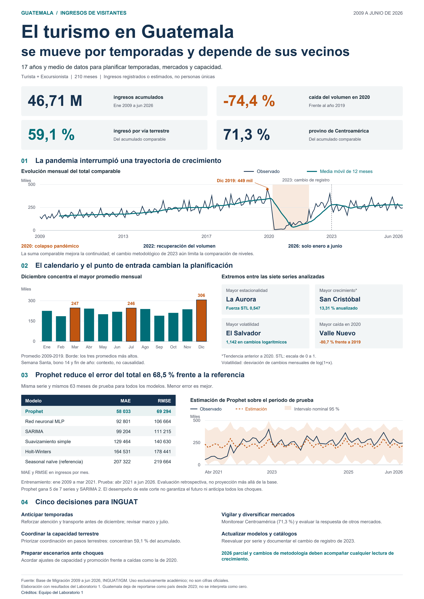

# Infografía del Laboratorio 09

Infografía de una página sobre los ingresos de visitantes a Guatemala entre enero de 2009 y junio de 2026. Utiliza los resultados del Laboratorio 1 y la definición `Turista + Excursionista`.

**Repositorio privado:** [Laboratorio09 Visualización Estática](https://github.com/Javiervalladares1/Laboratorio09-Visualizacion-Estatica).



**Copia final editable en Canva:** [Abrir el diseño](https://www.canva.com/d/MRzncvdKKInArxS). La copia verificada tiene 134 elementos de texto editables y los trazados originales en una imagen de fondo de alta resolución. Para editar los trazados por separado, usar el SVG o modificar el script de Python.

## Archivos de entrega

- [Documento de explicación del avance en PDF](documento/Explicacion_Diseno_Laboratorio09.pdf) y [versión editable en Word](documento/Explicacion_Diseno_Laboratorio09.docx). Se conservan las versiones elaboradas para el avance del 15 de octubre.
- [Infografía digital en PNG](salida/Infografia_Turismo_Guatemala.png).
- [Infografía para impresión en A3](salida/Infografia_Turismo_Guatemala_A3.pdf) y [alternativa de 11 × 17 pulgadas](salida/Infografia_Turismo_Guatemala_11x17.pdf).
- [Script principal de Python](scripts/crear_infografia.py) y [dependencias](requirements.txt).

Detalle de los formatos y fuentes editables:

- `salida/Infografia_Turismo_Guatemala.png`: versión digital de 2400 × 3394 px. Cumple ambos mínimos indicados en la guía, 1200 px de ancho y 2400 px de alto.
- `salida/Infografia_Turismo_Guatemala_A3.pdf`: una página A3 vertical, 297 × 420 mm, con gráficos y texto vectoriales.
- `salida/Infografia_Turismo_Guatemala_11x17.pdf`: una página de 11 × 17 pulgadas. Se incluye porque la guía menciona A3 y 11 × 17 como si fueran el mismo formato.
- `salida/Infografia_Turismo_Guatemala_Editable.svg`: texto y formas editables. Puede abrirse en Inkscape, Illustrator u otro editor de SVG.
- `scripts/crear_infografia.py`: script de Python que construye las tres versiones anteriores.
- `datos/`: insumos agregados, predicciones, intervalos y metadatos para reproducir la pieza sin duplicar la base completa.
- `editable/index.html` y `editable/graficos.png`: original HTML con texto separado y gráficos incluidos. `salida/Infografia_Editable_Canva.zip` contiene ese paquete para volver a importarlo a Canva sin hospedar archivos públicamente.

## Reproducción

Con Python 3.12 o posterior, instalar las dependencias de `requirements.txt` en un entorno virtual. Se requiere Arial o, como alternativa, Liberation Sans o DejaVu Sans. No se distribuyen archivos de fuentes comerciales.

Desde esta carpeta:

```bash
python scripts/crear_infografia.py
python scripts/verificar_entrega.py
```

Los intervalos ya están calculados. Solo si se necesita repetir ese ajuste:

```bash
python scripts/recuperar_intervalos.py
python scripts/crear_infografia.py
python scripts/verificar_entrega.py
```

También puede usarse el `Makefile`:

```bash
make instalar     # crea .venv e instala dependencias
make todo         # pruebas, generación de la pieza y verificación
make pruebas      # solo las pruebas de tests/
```

Los PDF se generan en modo invariante y el ZIP editable usa una fecha fija: regenerar la pieza sin cambiar datos ni código no produce diferencias en esos archivos.

### Pruebas y verificación

- `tests/` contiene pruebas con pytest sobre la coherencia de los insumos (serie completa, perfil mensual, participaciones, intervalo y metadatos) y sobre las utilidades de dibujo (formato numérico, escape en SVG, ajuste de párrafos y márgenes de toda la composición).
- `scripts/verificar_entrega.py` revisa cifras, formatos y textos de las exportaciones. Informa todos los fallos encontrados y termina con código 1 si alguno no se cumple.
- `.github/workflows/verificacion.yml` ejecuta ambos controles en GitHub Actions en cada push a `main` y en cada pull request.

`scripts/preparar_datos.py` sirve para volver a extraer los insumos desde la carpeta original del Laboratorio 1. Requiere conservar la ubicación de esta carpeta dentro de Lab1 y sus archivos originales en `outputs/lab1_final`.

## Créditos y colaboración

Editar `creditos.json` para introducir los nombres reales y el número de grupo; después volver a ejecutar el generador. Cada elemento de `autores` puede contener nombre y carné. Actualmente el pie identifica únicamente al equipo del Laboratorio 1, porque no se proporcionó su nómina confirmada.

El repositorio privado conserva los cambios realizados en código, SVG y exportaciones. Los commits generados por el asistente se identifican como Codex; no representan contribuciones de los demás integrantes. Para que el profesor y auxiliares puedan consultar los archivos y el historial, el propietario deberá concederles acceso al repositorio y al proyecto de Canva.

El diseño final de Canva está identificado en `enlaces.json`. Si se modifica el código y se vuelve a generar la pieza, esa operación actualiza los archivos locales; la copia de Canva debe volver a importarse o actualizarse por separado.

## Decisiones de visualización

La pieza sigue el avance: cuatro tarjetas en dos filas y dos columnas; línea mensual con media móvil de 12 meses; columnas mensuales anteriores a la pandemia; cuadrante con los extremos de las siete series; tabla de MAE y RMSE para la serie total; estimación e intervalo de Prophet; cinco recomendaciones. El orden conecta contexto, calendario, estimación y decisiones.

La paleta usa azul oscuro `#16324F`, verde azulado `#006D77` y acento naranja `#C05510`, con fondo blanco y neutros para texto secundario. Los colores sólidos tienen un contraste mayor a 4,5 a 1 frente al blanco. Las etiquetas acompañan los valores para no depender solo del color. El gráfico temporal conserva su orden cronológico; las columnas parten de cero; ambas series de pronóstico usan el mismo eje.

## Pronóstico e incertidumbre

Se mantienen 147 meses de entrenamiento, enero de 2009 a marzo de 2021, y 63 meses de prueba, abril de 2021 a junio de 2026. Se reajustó Prophet 1.2.1 con la misma configuración del laboratorio: estacionalidad aditiva, `changepoint_prior_scale=0.01`, `seasonality_prior_scale=10`, período anual 365,25 y orden de Fourier 6.

El reajuste permite recuperar `yhat_lower` y `yhat_upper` con intervalo nominal del 95 %, 2000 muestras y semilla NumPy 2026. La diferencia máxima respecto de la estimación puntual original es de 0,0987 ingresos, atribuible a precisión numérica del reajuste. La gráfica conserva exactamente los puntos y las métricas del Lab 1. Los límites inferiores negativos se llevan a cero porque la cantidad no puede ser negativa. Versiones, métricas y cobertura observada constan en `datos/metadatos_intervalo.json`.

El 95 % es el nivel nominal del modelo, no una garantía de cobertura ante cambios estructurales. La gráfica corresponde a evaluación retrospectiva, no a una predicción de fechas posteriores a junio de 2026. No se simularon intervalos usando las métricas del conjunto de prueba.

## Fuentes y límites

- Guía del Laboratorio 09 Visualización Estática 2026, CC3084 Data Science, UVG.
- `Base_Migracion_2009-2026jun.xlsx`, hojas Datos y Notas, con tramos de INGUAT/IGM y respaldos históricos.
- Informe, código y tablas del Laboratorio 1. Los SHA-256 de los archivos de entrada figuran en `datos/procedencia.json`.

Son datos exclusivamente académicos y no constituyen cifras oficiales. Se cuentan ingresos registrados o estimados, no personas únicas. La pandemia y el cambio metodológico de 2023 limitan la comparación de niveles. La categoría Guatemala deja de reportarse como país desde 2023; no se interpreta como cero. El año 2026 solo cubre enero a junio.

La guía restringe la difusión pública sin consulta previa. Mantener el repositorio y el proyecto compartido dentro del ámbito académico autorizado. Compartir el acceso con el profesor y auxiliares desde la herramienta del equipo.
